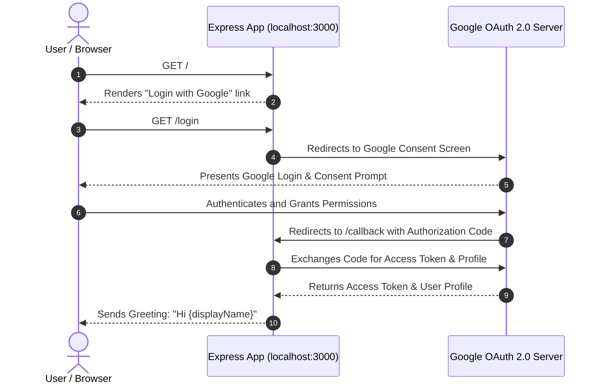

# Google OAuth 2.0 Authentication with Node.js & Passport

[](https://nodejs.org/)
[](https://expressjs.com/)
[](https://www.passportjs.org/)
[](https://opensource.org/licenses/ISC)

A minimal, clean, and production-ready starter template demonstrating **OAuth 2.0 authentication** using **Node.js**, **Express**, and **Passport.js** with the **Google OAuth 2.0 strategy** (`passport-google-oauth20`).

---

## 📌 Features

- 🔐 **OAuth 2.0 Authorization Code Flow** with Google Identity Services.
- ⚡ **Lightweight & Simple**: Minimal dependencies, easy to understand and integrate into existing projects.
- ⚙️ **Configurable Environment Variables**: Secure credential handling using `dotenv`.
- 🚀 **Express 5.x Ready**: Built using modern Express practices.
- 👤 **User Profile Extraction**: Retrieves basic user details (`displayName`, `id`, `profile` info) upon authorization.

---

## 🔄 OAuth 2.0 Authentication Flow

Here is how the authentication handshake works:



---

## 📁 Project Structure

```text
OAuth2.0/
├── .env.example       # Template for environment variables
├── .gitignore          # Git ignore rules (.env, node_modules)
├── index.js           # Express app setup and Google OAuth routes
├── package.json       # Project metadata and dependencies
└── README.md          # Project documentation
```

---

## 🛠️ Prerequisites

Before getting started, make sure you have:

- [Node.js](https://nodejs.org/) (version 18.x or later)
- [npm](https://www.npmjs.com/) (installed with Node.js)
- A [Google Cloud Console](https://console.cloud.google.com/) account to generate OAuth 2.0 credentials.

---

## 🔑 Google Cloud Console Setup

1. **Create / Select a Project**:
   - Go to [Google Cloud Console](https://console.cloud.google.com/).
   - Click on the project dropdown at the top and click **New Project**. Name your project (e.g., `OAuth-Demo`).

2. **Configure the OAuth Consent Screen**:
   - Navigate to **APIs & Services** > **OAuth consent screen**.
   - Choose **External** (or **Internal** if using Google Workspace) and click **Create**.
   - Fill in the required fields:
     - **App name**: e.g., `My Express Auth App`
     - **User support email**: Your email address
     - **Developer contact information**: Your email address
   - Under **Scopes**, click **Save and Continue** (default `profile` scope is sufficient).
   - Under **Test Users**, add your Google email address so you can test logging in while the app is in testing status.
   - Click **Save and Continue**.

3. **Generate OAuth 2.0 Client ID and Secret**:
   - Navigate to **APIs & Services** > **Credentials**.
   - Click **+ CREATE CREDENTIALS** > **OAuth client ID**.
   - Set **Application type** to `Web application`.
   - Name your client (e.g., `Express Web Client`).
   - In **Authorized JavaScript origins**, add:
     ```text
     http://localhost:3000
     ```
   - In **Authorized redirect URIs**, add:
     ```text
     http://localhost:3000/callback
     ```
   - Click **Create**.
   - Copy your **Client ID** and **Client Secret**.

---

## 🚀 Getting Started

### 1. Clone the Repository

```bash
git clone https://github.com/maharshi-desai/OAuth2.0.git
cd OAuth2.0
```

### 2. Install Dependencies

```bash
npm install
```

### 3. Configure Environment Variables

Create a `.env` file in the root directory by copying the example template:

```bash
cp .env.example .env
```

Open `.env` and fill in your credentials from Google Cloud Console:

```env
ClientID=YOUR_GOOGLE_CLIENT_ID.apps.googleusercontent.com
ClientSecret=YOUR_GOOGLE_CLIENT_SECRET
```

### 4. Start the Application

```bash
npm start
```

Or run directly with Node:

```bash
node index.js
```

You should see:
```text
Example app listening on port 3000
```

---

## 🌐 Endpoints

| Method | Endpoint    | Description |
|:-------|:------------|:--------------------------------------------------------|
| `GET`  | `/`         | Home page with the "Login with google" link |
| `GET`  | `/login`    | Initiates the Google OAuth 2.0 authentication process |
| `GET`  | `/callback` | Google OAuth callback URL (validates authorization & returns user info) |

---

## 🔒 Security & Best Practices for Production

- **Session Management**: For persistent user sessions across requests, integrate [`express-session`](https://www.npmjs.com/package/express-session) and configure Passport serialize/deserialize user methods.
- **HTTPS & Secure Cookies**: In production, always serve your application over HTTPS and set secure cookie flags (`secure: true`, `httpOnly: true`, `sameSite: 'lax'`).
- **Secret Protection**: Never commit your `.env` file containing secrets to version control. Keep `.env` listed in `.gitignore`.
- **Database Integration**: Persist the authenticated Google user profile (Google ID, email, avatar) in your database (e.g., MongoDB, PostgreSQL) during the callback verification function.

---

## 📄 License

This project is licensed under the [ISC License](LICENSE).

---

## 👤 Author

**Maharshi Desai**
- GitHub: [@maharshi-desai](https://github.com/maharshi-desai)
